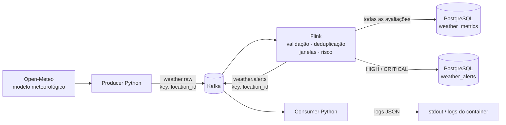

# Arquitetura do MVP

O sistema coleta previsões atuais da Open-Meteo, calcula métricas e risco em janelas e persiste resultados no PostgreSQL. Somente risco `HIGH` ou `CRITICAL` também vira mensagem em `weather.alerts`; o consumer valida essa mensagem e a registra em stdout como JSON.

## Serviços e tópicos

| Serviço | Responsabilidade |
| --- | --- |
| `producer` | Consulta RJ01, SP01 e CT01 em sequência, valida eventos e publica em `weather.raw`. |
| `kafka` | Broker KRaft local, com auto-criação de tópicos desabilitada. O Producer cria `weather.raw` e `weather.alerts` com três partições e replicação 1; `weather.alerts` recebe saída do Flink. |
| `flink-jobmanager` e `flink-taskmanager` | Executam um job standalone com um slot. O job lê `weather.raw` no grupo `weather-flink-ingestion`; a submissão e a retomada por checkpoint são explícitas. |
| `postgres` | Armazena o catálogo e os fatos do domínio no schema `climate`. |
| `alert-consumer` | Valida alertas de `weather.alerts`, registra logs JSON e confirma offsets após escrever e descarregar cada log. |

As duas chaves Kafka são o `location_id` codificado em UTF-8. `weather.raw` contém o evento v1; `weather.alerts` contém o alerta de 22 campos e só recebe avaliações elegíveis. Não há Schema Registry: as versões e validações pertencem ao código.

## Contratos de dados

O Producer serializa `WeatherEvent` como JSON compacto. Os 15 campos validados pelo parser são:

| Campo | Tipo ou unidade | Significado |
| --- | --- | --- |
| `location_id`, `city` | texto | Código e nome da localidade cadastrada. |
| `latitude`, `longitude` | graus decimais | Coordenadas da localidade. |
| `temperature` | °C | Temperatura atual modelada. |
| `precipitation` | mm | Precipitação acumulada no intervalo retornado pela fonte. |
| `wind_speed`, `wind_gust` | km/h | Velocidade média e rajada do vento. |
| `visibility` | m | Visibilidade. |
| `weather_code` | inteiro WMO | Código meteorológico da fonte. |
| `measurement_interval_seconds` | segundos, de 1 a 3600 | Intervalo associado à observação. |
| `event_timestamp`, `ingestion_timestamp` | ISO 8601 UTC, terminado em `Z` | Validade da observação e término da coleta, respectivamente. |
| `source` | `open-meteo` | Identificador fixo da fonte. |
| `schema_version` | inteiro `1` | Versão do contrato do evento. |

Os eventos da API representam dados de modelo, não medições de estação. Fixtures históricas são usadas em QA; mensagens e linhas de fixture retidas devem ser distinguidas pelos seus identificadores e timestamps, não apresentadas como alertas meteorológicos atuais.

## Tempo, janelas e risco

O Flink usa `event_timestamp` como Event Time e uma marca d'água com até 120 segundos de desordem; uma partição ociosa é excluída do avanço após 60 segundos. Janelas deslizantes de 30 minutos avançam a cada 5 minutos, alinhadas ao epoch UTC e no intervalo `[início, fim)`. Atraso permitido é zero: os 120 segundos afetam o avanço da marca d'água, mas não reabrem uma janela fechada.

A deduplicação de eventos usa a identidade `(location_id, event_timestamp normalizado em UTC)` em estado gerenciado pelo Flink, com TTL de 24 horas em processing time. Repetições não renovam o prazo. As métricas por localidade guardam contagem, média de temperatura, extremos de vento/rajada/visibilidade e intervalos e timestamps extremos. `precipitation_max` é um máximo; a projeção horária usada pelo risco é `precipitation × 3600 / measurement_interval_seconds`, não chuva acumulada na janela.

A versão atual de regras é `mvp-1`. Cada fator recebe score 0, 25, 50, 75 ou 100; o risco final é o maior score entre os fatores, sem soma. Limites de precipitação, vento e rajada são inclusivos; visibilidade usa limites estritos:

| Fator | Unidade e limites dos scores 25 / 50 / 75 / 100 |
| --- | --- |
| Projeção máxima de precipitação | mm/h: `>=2 / >=20 / >=30 / >=60` |
| Velocidade máxima do vento | km/h: `>=20 / >=40 / >=60 / >=100` |
| Rajada máxima | km/h: `>=30 / >=50 / >=80 / >=120` |
| Visibilidade mínima | m: `<5000 / <2000 / <1000 / <200` |

As faixas são `LOW` (0–24), `MEDIUM` (25–49), `HIGH` (50–74) e `CRITICAL` (75–100). A regra é uma classificação heurística ordinal do MVP; não representa probabilidade de prejuízo. Extremos de uma janela podem vir de observações diferentes.

## PostgreSQL e identidade

| Tabela | Conteúdo e identidade |
| --- | --- |
| `climate.locations` | Catálogo; chave primária `location_id`. |
| `climate.weather_metrics` | Uma avaliação por `(location_id, window_start_ms, window_end_ms, risk_rules_version)`. |
| `climate.weather_alerts` | Alertas elegíveis; chave primária `alert_id` e unicidade adicional pela identidade da avaliação. |

O `alert_id` é SHA-256 do JSON UTF-8 compacto da identidade `[location_id, window_start_ms, window_end_ms, risk_rules_version]`. O UPSERT de uma avaliação e seu alerta elegível ocorre em uma instrução SQL no PostgreSQL; o replay converge pela identidade e não altera a identidade imutável da métrica. A role de aplicação lê `locations` e tem `SELECT`, `INSERT` e `UPDATE` nas duas tabelas de fatos; não recebe DDL, exclusão ou privilégios administrativos.

Checkpoints Flink usam `EXACTLY_ONCE` para estado gerenciado e offsets do source. Essa garantia não se estende aos sinks: o UPSERT torna a persistência SQL repetível, enquanto o sink Kafka é `AT_LEAST_ONCE` e pode repetir alertas após recuperação. Não existe transação distribuída entre PostgreSQL e Kafka. O consumer usa cache FIFO volátil de 10.000 IDs; reinício, evicção ou falha entre o log e o commit podem repetir uma saída. Não há exatamente uma vez ponta a ponta.

## Operação, segurança e limites

Os healthchecks indicam prontidão dos serviços. O job precisa aparecer como `RUNNING` em `/jobs/overview`; reiniciar o JobManager standalone pode deixar a infraestrutura saudável sem job ativo. Não há alta disponibilidade nem submissão automática. Consulte o README para os comandos de inicialização, verificação e retomada com o `_metadata` de um checkpoint persistido.

Os limites de memória do Compose somam 4,375 GiB; a recomendação operacional é reservar pelo menos 6 GiB e cerca de 4 vCPUs para o Docker. Em uma execução pequena de entrega registrada na Etapa 8, JobManager e TaskManager foram observados em 551,3 MiB e 594,7 MiB; CPU registrada foi 1,70% e 2,10%, com backpressure `ok`. Essa amostra não é benchmark e não informa throughput sustentado.

Kafka é um nó local com PLAINTEXT, replicação 1 e sem TLS, SASL ou ACLs. O REST Flink é sem autenticação, mas fica vinculado ao loopback do host. Producer e consumer usam UID 10001; Flink executa como usuário `flink`. `.env` guarda credenciais locais fora do Git. A role PostgreSQL da aplicação tem privilégios restritos, e as credenciais administrativas não são fornecidas aos containers Python.

O consumer pode permanecer saudável sem mensagens novas: healthcheck mede processo, assignment, metadata e heartbeat. Ausência de `alert_received` pode significar que nenhuma janela alcançou HIGH ou CRITICAL; não indica falha por si só. QA usa fixtures, portanto alertas históricos dessa origem também não são evidência de condição atual.

Melhorias futuras fora do MVP: autenticação e criptografia no Kafka, alta disponibilidade e retomada automatizada do Flink, e deduplicação durável do consumer. O sistema atual opera com um broker e um slot Flink, sem benchmark de throughput ou garantia transacional de ponta a ponta.

## Fontes de verdade

Os contratos, limiares e identidades devem ser conferidos no código e no schema atual: [Compose](../compose.yaml), [modelo do evento](../src/climate_logistics/models.py), [parser e campos](../src/climate_logistics/weather_parser.py), [job Flink](../src/climate_logistics/flink_job.py), [janelas](../src/climate_logistics/flink_temporal.py), [agregações](../src/climate_logistics/temporal_metrics.py), [regras de risco](../src/climate_logistics/risk_engine.py), [registros e hash](../src/climate_logistics/business_records.py), [SQL de negócio](../src/climate_logistics/business_sql.py), [consumer](../src/climate_logistics/alert_consumer.py) e [migração PostgreSQL](../docker/postgres/migrations/001-business-sinks.sql).
