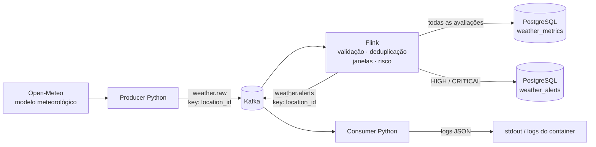

# Arquitetura do projeto

O sistema coleta previsões atuais da Open-Meteo. O Flink calcula métricas e riscos em janelas e grava os resultados no PostgreSQL. Quando o risco é `HIGH` ou `CRITICAL`, o Flink também publica um alerta em `weather.alerts`. O consumer valida a mensagem e registra o resultado em JSON no stdout.

## Serviços e tópicos

| Serviço | Responsabilidade |
| --- | --- |
| `producer` | Consulta RJ01, SP01 e CT01 em sequência, valida eventos e publica em `weather.raw`. |
| `kafka` | Broker KRaft local, com auto-criação de tópicos desabilitada. O Producer cria `weather.raw` e `weather.alerts` com três partições e replicação 1; `weather.alerts` recebe saída do Flink. |
| `flink-jobmanager` e `flink-taskmanager` | Executam um job standalone com um slot. O job lê `weather.raw` no grupo `weather-flink-ingestion`; a submissão e a retomada por checkpoint são explícitas. |
| `postgres` | Armazena o catálogo e os fatos do domínio no schema `climate`. |
| `alert-consumer` | Valida alertas de `weather.alerts`, registra logs JSON e confirma offsets após escrever e descarregar cada log. |

Os dois tópicos usam o `location_id` codificado em UTF-8 como chave. `weather.raw` contém eventos v1. `weather.alerts` contém alertas com 22 campos e recebe apenas avaliações elegíveis. O código controla as versões e validações; o projeto não usa Schema Registry.

## Contratos de dados

O Producer serializa `WeatherEvent` como JSON compacto. Os 15 campos validados pelo parser são:

| Campo | Tipo ou unidade | Significado |
| --- | --- | --- |
| `location_id`, `city` | texto | Código e nome da localidade cadastrada. |
| `latitude`, `longitude` | graus decimais | Coordenadas da localidade. |
| `temperature` | °C | Temperatura atual modelada. |
| `precipitation` | mm | Precipitação acumulada no intervalo retornado pela fonte. |
| `wind_speed`, `wind_gust` | km/h | Velocidade média e rajada do vento. |
| `visibility` | m | Visibilidade. |
| `weather_code` | inteiro WMO | Código meteorológico da fonte. |
| `measurement_interval_seconds` | segundos, de 1 a 3600 | Intervalo associado à observação. |
| `event_timestamp`, `ingestion_timestamp` | ISO 8601 UTC, terminado em `Z` | Validade da observação e término da coleta, respectivamente. |
| `source` | `open-meteo` | Identificador fixo da fonte. |
| `schema_version` | inteiro `1` | Versão do contrato do evento. |

A API fornece previsões de modelo, não medições de estações meteorológicas. No QA, usamos fixtures históricas. Identificadores e timestamps ajudam a distinguir mensagens e linhas retidas dessas fixtures, que não representam alertas atuais.

## Tempo, janelas e risco

O Flink usa `event_timestamp` como Event Time. A marca d'água tolera até 120 segundos de desordem; depois de 60 segundos sem atividade, uma partição ociosa deixa de participar do avanço. As janelas deslizantes duram 30 minutos, avançam a cada 5 minutos, seguem o epoch UTC e incluem o início, mas não o fim, no intervalo `[início, fim)`. O atraso permitido é zero. Os 120 segundos afetam o avanço da marca d'água, mas não reabrem uma janela fechada.

O Flink identifica eventos duplicados pela identidade `(location_id, event_timestamp normalizado em UTC)`. Guarda essas identidades em estado gerenciado por 24 horas de processing time. Repetições não renovam esse prazo. Para cada localidade, as métricas guardam a contagem, a média de temperatura, os extremos de vento, rajada e visibilidade, além dos intervalos e timestamps extremos. `precipitation_max` guarda o maior valor. Para calcular o risco, usamos a projeção horária `precipitation × 3600 / measurement_interval_seconds`; ela não representa a chuva acumulada na janela.

A versão atual das regras é `mvp-1`. Cada fator recebe score 0, 25, 50, 75 ou 100. O maior score define o risco final; os scores não são somados. Os limites de precipitação, vento e rajada são inclusivos. Os de visibilidade são estritos:

| Fator | Unidade e limites dos scores 25 / 50 / 75 / 100 |
| --- | --- |
| Projeção máxima de precipitação | mm/h: `>=2 / >=20 / >=30 / >=60` |
| Velocidade máxima do vento | km/h: `>=20 / >=40 / >=60 / >=100` |
| Rajada máxima | km/h: `>=30 / >=50 / >=80 / >=120` |
| Visibilidade mínima | m: `<5000 / <2000 / <1000 / <200` |

As faixas são `LOW` (0–24), `MEDIUM` (25–49), `HIGH` (50–74) e `CRITICAL` (75–100). Essa regra é uma classificação ordinal e heurística do MVP, não uma probabilidade de prejuízo. Os extremos de uma janela podem vir de observações diferentes.

## PostgreSQL e identidade

| Tabela | Conteúdo e identidade |
| --- | --- |
| `climate.locations` | Catálogo; chave primária `location_id`. |
| `climate.weather_metrics` | Uma avaliação por `(location_id, window_start_ms, window_end_ms, risk_rules_version)`. |
| `climate.weather_alerts` | Alertas elegíveis; chave primária `alert_id` e unicidade adicional pela identidade da avaliação. |

Calculamos `alert_id` com SHA-256 sobre o JSON UTF-8 compacto da identidade `[location_id, window_start_ms, window_end_ms, risk_rules_version]`. Uma única instrução SQL faz o UPSERT da avaliação e, quando elegível, do alerta. No replay, o PostgreSQL reconhece a avaliação pela identidade e mantém a identidade imutável da métrica. A role de aplicação lê `locations` e tem `SELECT`, `INSERT` e `UPDATE` nas duas tabelas de fatos. Ela não recebe DDL, exclusão ou privilégios administrativos.

Os checkpoints Flink usam `EXACTLY_ONCE` para o estado gerenciado e os offsets do source. A garantia não cobre os sinks. O UPSERT permite repetir a gravação SQL, enquanto o sink Kafka usa `AT_LEAST_ONCE` e pode repetir alertas após uma recuperação. PostgreSQL e Kafka não participam de uma transação distribuída. O consumer mantém em memória um cache FIFO volátil de 10.000 IDs. Um reinício, uma evicção ou uma falha entre o log e o commit pode repetir uma saída. Não há exatamente uma vez ponta a ponta.

## Operação, segurança e limites

Os healthchecks mostram se os serviços estão prontos. O job também precisa aparecer como `RUNNING` em `/jobs/overview`. Um reinício do JobManager standalone pode deixar a infraestrutura saudável, mas sem job ativo. Não há alta disponibilidade nem submissão automática. O README traz os comandos de inicialização, verificação e retomada usando o `_metadata` de um checkpoint persistido.

Os limites de memória do Compose somam 4,375 GiB. Para operar, recomendamos reservar pelo menos 6 GiB e cerca de 4 vCPUs para o Docker. Em uma execução pequena de entrega registrada na Etapa 8, o JobManager usou 551,3 MiB e o TaskManager, 594,7 MiB. O uso de CPU registrado foi 1,70% e 2,10%, com backpressure `ok`. Essa amostra não é um benchmark e não informa o throughput sustentado.

Kafka roda em um nó local com PLAINTEXT e replicação 1, sem TLS, SASL ou ACLs. A API REST do Flink não tem autenticação e fica vinculada ao loopback do host. Producer e consumer usam UID 10001; Flink roda como usuário `flink`. O arquivo `.env` guarda credenciais locais fora do Git. A role da aplicação no PostgreSQL tem privilégios restritos, e os containers Python não recebem credenciais administrativas.

O consumer pode continuar saudável sem mensagens novas. O healthcheck verifica o processo, o assignment, a metadata e o heartbeat. A falta de `alert_received` pode indicar que nenhuma janela chegou a HIGH ou CRITICAL; por si só, não indica falha. O QA usa fixtures, então alertas históricos gerados a partir delas também não mostram condições atuais.

Para uma próxima versão, ficam a autenticação e a criptografia no Kafka, a alta disponibilidade e a retomada automática do Flink, além da deduplicação durável do consumer. Hoje, o sistema opera com um broker e um slot Flink, sem benchmark de throughput ou garantia transacional ponta a ponta.

## Fontes de verdade

Confira os contratos, limiares e identidades no código e no schema atual: [Compose](../compose.yaml), [modelo do evento](../src/climate_logistics/models.py), [parser e campos](../src/climate_logistics/weather_parser.py), [job Flink](../src/climate_logistics/flink_job.py), [janelas](../src/climate_logistics/flink_temporal.py), [agregações](../src/climate_logistics/temporal_metrics.py), [regras de risco](../src/climate_logistics/risk_engine.py), [registros e hash](../src/climate_logistics/business_records.py), [SQL de negócio](../src/climate_logistics/business_sql.py), [consumer](../src/climate_logistics/alert_consumer.py) e [migração PostgreSQL](../docker/postgres/migrations/001-business-sinks.sql).

## Arquivos versionados do projeto

O inventário lista os 78 arquivos versionados do projeto. `.env`, `.venv` e `.git` são locais ou gerados, então ficam de fora. `.env.example` é o modelo versionado de configuração e não contém credenciais locais.

`requirements.txt` é o único arquivo de dependências. Ele reúne as versões fixadas da aplicação (`requests==2.34.2`, `confluent-kafka==2.12.2`), da qualidade (`pytest==8.4.2`, `ruff==0.14.0`) e do Flink (`apache-flink==1.20.3`).

Cada componente instala apenas os pacotes de que precisa. A opção `-c requirements.txt` faz o pip usar as versões fixadas nesse arquivo, sem instalar todos os pacotes listados. Producer e consumer usam os dois pacotes da aplicação. A qualidade local e os jobs `quality` e `python-kafka` da CI usam os pacotes da aplicação e as ferramentas de qualidade. A imagem Flink instala apenas `apache-flink`; o job `flink-sdk` instala `pytest` e `ruff` sobre o runtime que já está na imagem.

Assim, cada pacote tem sua versão declarada uma vez e cada imagem recebe apenas as dependências necessárias.

### Raiz, configuração e documentação

| Arquivo | Função |
| --- | --- |
| `.dockerignore` | Exclui arquivos locais e desnecessários do contexto de build das imagens. |
| `.env.example` | Modelo de variáveis do Compose; nomes de banco e usuários ficam definidos, e os campos de senha devem ser preenchidos localmente. |
| `.gitattributes` | Padroniza atributos Git, incluindo finais de linha de scripts shell. |
| `.github/workflows/ci.yml` | Define os jobs de CI para qualidade Python, integração Kafka e runtime/SDK Flink. |
| `.gitignore` | Exclui ambientes virtuais, segredos, caches e provas locais do Git. |
| `README.md` | Orienta preparação, operação, verificação, QA e limites do MVP. |
| `compose.yaml` | Define serviços, redes, volumes, recursos, healthchecks e configuração local do sistema. |
| `pyproject.toml` | Configura projeto Python, pytest, Ruff e metadados das ferramentas. |
| `requirements.txt` | Pins de aplicação, qualidade e runtime Flink; cada imagem e ambiente instala seu subconjunto sob constraints. |
| `docs/arquitetura.md` | Descreve fluxo, componentes, contratos, garantias, limites e inventário do código. |
| `docs/progresso.md` | Registra entregas, desafios, correções e validações das dez etapas concluídas. |
| `sql/.gitkeep` | Mantém versionado o diretório reservado a SQL fora das migrações do PostgreSQL. |

### Imagens e inicialização dos serviços

| Arquivo | Função |
| --- | --- |
| `docker/flink/Dockerfile` | Constrói o runtime compartilhado do Flink JobManager e TaskManager. |
| `docker/flink/checksums.sha256` | Fixa os hashes dos artefatos externos usados na imagem Flink. |
| `docker/flink/healthcheck.sh` | Verifica a prontidão da API REST e o registro do TaskManager. |
| `docker/flink/java/org/climatelogistics/AlertRecordSerializationSchema.java` | Serializa registros de alerta do sink Kafka para bytes. |
| `docker/flink/java/org/climatelogistics/BusinessJdbcStatementBuilder.java` | Mapeia linhas Flink aos parâmetros da escrita JDBC de negócio. |
| `docker/postgres/01-bootstrap.sh` | Inicializa banco, usuários, schema e privilégios do PostgreSQL. |
| `docker/postgres/02-business-schema.sh` | Aplica a migração do schema de negócio na inicialização do serviço. |
| `docker/postgres/locations.csv` | Fornece os dados iniciais do catálogo de localidades ao PostgreSQL. |
| `docker/postgres/migrations/001-business-sinks.sql` | Cria tabelas, chaves, restrições e permissões dos destinos de negócio. |
| `docker/producer/Dockerfile` | Constrói a imagem Python não-root compartilhada pelo Producer e pelo consumer. |
| `scripts/render_location_seed.py` | Gera `docker/postgres/locations.csv` a partir do catálogo Python de localidades. |

### Pacote Python `src/climate_logistics`

| Arquivo | Função |
| --- | --- |
| `src/climate_logistics/__init__.py` | Marca e identifica o pacote Python da aplicação. |
| `src/climate_logistics/alert_consumer.py` | Executa o consumer Kafka: valida alertas, emite logs JSON e confirma offsets após o flush. |
| `src/climate_logistics/business_config.py` | Lê e valida configurações de conexão e escrita dos sinks de negócio. |
| `src/climate_logistics/business_records.py` | Valida registros de métricas/alertas e calcula identidades e fingerprints determinísticos. |
| `src/climate_logistics/business_sql.py` | Define o UPSERT parametrizado e atômico das métricas e dos alertas elegíveis. |
| `src/climate_logistics/consumer_health.py` | Grava heartbeat atômico e implementa a verificação de saúde do consumer. |
| `src/climate_logistics/data_quality.py` | Valida coerência temporal e define identidade lógica de eventos meteorológicos. |
| `src/climate_logistics/flink_business.py` | Adapta avaliações do Flink para os sinks JDBC do PostgreSQL e Kafka. |
| `src/climate_logistics/flink_job.py` | Monta e submete o job de ingestão, validação, deduplicação e encaminhamento de eventos. |
| `src/climate_logistics/flink_risk.py` | Anexa o cálculo de risco às métricas de janela no grafo Flink. |
| `src/climate_logistics/flink_temporal.py` | Configura Event Time, watermarks, janelas, métricas tardias e checkpoints do Flink. |
| `src/climate_logistics/kafka_publisher.py` | Cria/verifica tópicos e publica eventos com serialização e confirmação de entrega. |
| `src/climate_logistics/locations.py` | Mantém e valida o catálogo de localidades monitoradas. |
| `src/climate_logistics/models.py` | Define os modelos imutáveis `Location` e `WeatherEvent` e valida seus campos. |
| `src/climate_logistics/open_meteo.py` | Normaliza respostas e implementa o cliente HTTP resiliente da Open-Meteo. |
| `src/climate_logistics/producer.py` | Executa ciclos de coleta por localidade e publicação no Kafka. |
| `src/climate_logistics/risk_engine.py` | Calcula scores, níveis e componentes de risco de forma pura e determinística. |
| `src/climate_logistics/temporal_metrics.py` | Agrega métricas escalares das janelas temporais por localidade. |
| `src/climate_logistics/weather_parser.py` | Valida JSON Kafka e converte eventos para o formato de linha do Flink. |

### Fixtures e testes de integração

| Arquivo | Função |
| --- | --- |
| `tests/fixtures/open_meteo_current.json` | Fixture de resposta atual da API para testes de contrato e normalização. |
| `tests/integration/.gitkeep` | Mantém o diretório de testes de integração no Git. |
| `tests/integration/business_qa_support.py` | Compara snapshots e diferenças semânticas de registros de negócio durante QA. |
| `tests/integration/test_alert_consumer_integration.py` | Exercita consumer, duplicatas, inválidos, offsets, healthcheck e retomada com Kafka real. |
| `tests/integration/test_flink_business.py` | Verifica sinks de negócio, replay, checkpoint e restauração em serviços reais. |
| `tests/integration/test_flink_business_faults.py` | Verifica recuperação do Flink após falha temporária de PostgreSQL ou Kafka. |
| `tests/integration/test_flink_risk.py` | Confere contratos de risco e restauração de checkpoint em Flink real. |
| `tests/integration/test_flink_temporal.py` | Confere janelas, atraso, deduplicação e recuperação temporal em Flink real. |
| `tests/integration/test_kafka_flink.py` | Verifica publicação Kafka e processamento bounded/unbounded pelo Flink. |
| `tests/integration/test_open_meteo_http.py` | Exercita HTTP em servidor local, incluindo retries, limites e respostas inválidas. |
| `tests/integration/test_open_meteo_live.py` | Smoke opt-in do contrato contra a API pública Open-Meteo. |
| `tests/integration/test_postgres_business.py` | Verifica migração, privilégios, replay, imutabilidade e atomicidade no PostgreSQL. |
| `tests/integration/test_producer_kafka.py` | Verifica entrega Kafka real, tratamento de falha e CLI do Producer. |

### Testes unitários e de runtime

| Arquivo | Função |
| --- | --- |
| `tests/unit/.gitkeep` | Mantém o diretório de testes unitários no Git. |
| `tests/unit/test_alert_consumer.py` | Testa validação, processamento, configuração, offsets e ciclo de vida do consumer. |
| `tests/unit/test_alert_records.py` | Testa contrato, identidade, fingerprint e cache de registros de alerta. |
| `tests/unit/test_business_config.py` | Testa validação das configurações dos sinks de negócio. |
| `tests/unit/test_business_records.py` | Testa parsing, validação e identidades de métricas e alertas. |
| `tests/unit/test_business_schema.py` | Testa definições e restrições do schema PostgreSQL de negócio. |
| `tests/unit/test_consumer_health.py` | Testa heartbeat e critérios de saúde do consumer. |
| `tests/unit/test_data_quality.py` | Testa política temporal e deduplicação lógica de eventos. |
| `tests/unit/test_flink_business_fixtures.py` | Testa fixtures e helpers que compõem registros para os sinks. |
| `tests/unit/test_flink_business_sdk.py` | Verifica configuração dos sinks contra o SDK PyFlink. |
| `tests/unit/test_flink_job.py` | Testa configuração e funções de construção/submissão do job Flink. |
| `tests/unit/test_flink_qa_helpers.py` | Testa validações de identidade e opções de execução usadas pelo QA Flink. |
| `tests/unit/test_flink_risk_sdk.py` | Verifica a integração do adaptador de risco com o SDK PyFlink. |
| `tests/unit/test_flink_temporal_sdk.py` | Verifica estratégias de watermark, janelas e checkpoints no SDK PyFlink. |
| `tests/unit/test_kafka_publisher.py` | Testa serialização, configuração de tópicos e publicação Kafka. |
| `tests/unit/test_locations.py` | Testa catálogo e invariantes das localidades. |
| `tests/unit/test_models.py` | Testa modelos meteorológicos e validação de seus campos. |
| `tests/unit/test_normalization.py` | Testa conversão dos campos da API Open-Meteo para `WeatherEvent`. |
| `tests/unit/test_open_meteo_client.py` | Testa transporte HTTP, timeout, retry e erros do cliente. |
| `tests/unit/test_producer.py` | Testa ciclos, configuração e encerramento do Producer. |
| `tests/unit/test_risk_engine.py` | Testa scores, níveis e composição do motor de risco. |
| `tests/unit/test_temporal_metrics.py` | Testa agregações e contrato das métricas temporais. |
| `tests/unit/test_weather_parser.py` | Testa parsing e validação do evento consumido pelo Flink. |
